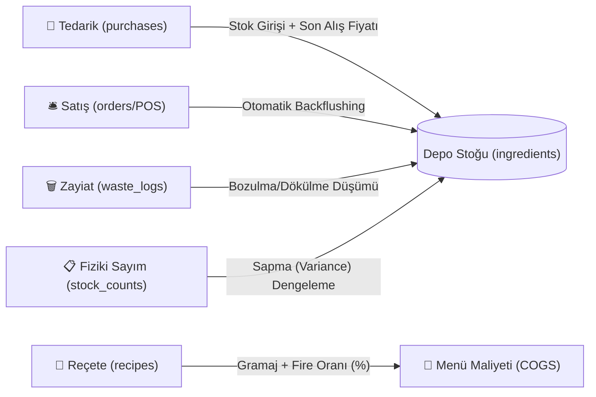

# 🍳 Mutfak ERP | Profesyonel Restoran Stok, Reçete ve Maliyet Yönetim Sistemi

[](https://nodejs.org)
[](https://sqlite.org)
[]()
[](LICENSE)

Restoran ve mutfak operasyonları için geliştirilmiş; **canlı Food Cost (%) analizi**, **otomatik reçete bazlı stok düşümü (Backflushing)**, **fiziki sayım sapma (Variance) dengelemesi** ve **zayiat/fire takibi** sunan yeni nesil mutfak ERP sistemi.

---

## 📌 Proje Veri Akışı ve Mutfak Yaşam Döngüsü



---

## 🗓️ GitHub Çok Günlü Geliştirme Yol Haritası (Development Roadmap)

Bu proje, profesyonel bir yazılım geliştirme sürecini simüle edecek şekilde modüler fazlara ayrılmıştır:

| Faz / Gün | Kapsam | Durum |
|---|---|---|
| **Gün 1** | 🏛️ **Temel Mimari & Veritabanı Şeması**: Proje iskeleti, `.gitignore`, SQLite ilişkisel DDL şeması, sanal kolonlar (`STORED GENERATED`) ve başlangıç tohumlama mekanizması. | ✅ **Yayınlandı** |
| **Gün 2** | ⚡ **Tetikleyiciler & Backflushing Motoru**: Otomatik stok giriş, reçeteli sipariş düşümü (`trg_order_item_backflush`), iptal iadesi, zayiat ve fiziki sayım senkronizasyon tetikleyicileri + birim testler (`tests/triggers.test.js`). | ✅ **Yayınlandı** |
| **Gün 3** | 🔌 **Backend REST API & Analitik Sorgular**: Express.js servisleri, Food Cost % hesabı (Query B), Menü Karlılığı (Query A), Kritik Stok Servisi (Query C) ve Sapma Analizi (Query D) + API testleri (`tests/api.test.js`). | ✅ **Yayınlandı** |
| **Gün 4 (Bugün)** | 🖥️ **Frontend & POS Arayüzü**: Dokunmatik POS ekranı, canlı adisyon sepeti, gerçek zamanlı stok kartları, reçete maliyet simülatörü ve Tailwind CSS teması (`public/`). | ✅ **Yayınlandı** |
| **Gün 5** | 📊 **Fiziki Sayım Modülü, Raporlar & v1.0.0 Release**: Sayım eşitleme modalı, Menü Mühendisliği Matrisi (BCG), nihai testler ve sürüm yayını. | ⏳ Planlandı |

---

## 📦 Gün 1: Veritabanı Varlıkları ve Tablo Modelleri

1. **`ingredients`**: Hammaddeler, ölçü birimi, son alış fiyatı, mevcut stok ve kritik minimum eşik seviyesi.
2. **`menu_items`**: Satışa sunulan porsiyon ürünler, satış fiyatı ve kategoriler.
3. **`recipes`**: Menü ürünü ile hammaddeler arasındaki çoka-çok (Many-to-Many) reçete bağlantısı, net porsiyon miktarı ve porsiyon fire oranı (`unit_waste_rate %`).
4. **`waste_logs`**: Dökülme, yanma, bozulma veya SKT geçme kaynaklı zayiat hareketleri.
5. **`purchases` & `purchase_items`**: Alış faturaları ve otomatik satır toplamı hesaplayan sanal kolonlar (`line_total STORED GENERATED`).
6. **`orders` & `order_items`**: POS ve masa siparişleri, satış tutarları ve kaynak bilgisi.
7. **`stock_counts` & `stock_count_items`**: Dönemsel fiziki sayım oturumları, teorik stok, fiziki sayılan ve sapma farkı (`variance_qty`).

---

## 🚀 Hızlı Kurulum ve Çalıştırma (Gün 1)

```bash
# 1. Depoyu klonlayın
git clone https://github.com/KULLANICI_ADINIZ/mutfak-erp.git
cd mutfak-erp

# 2. Bağımlılıkları yükleyin
npm install

# 3. Şemayı ve test veritabanını test edin
node test_schema.js
```

---

## 📄 Lisans
Bu proje [MIT](LICENSE) lisansı ile lisanslanmıştır.
