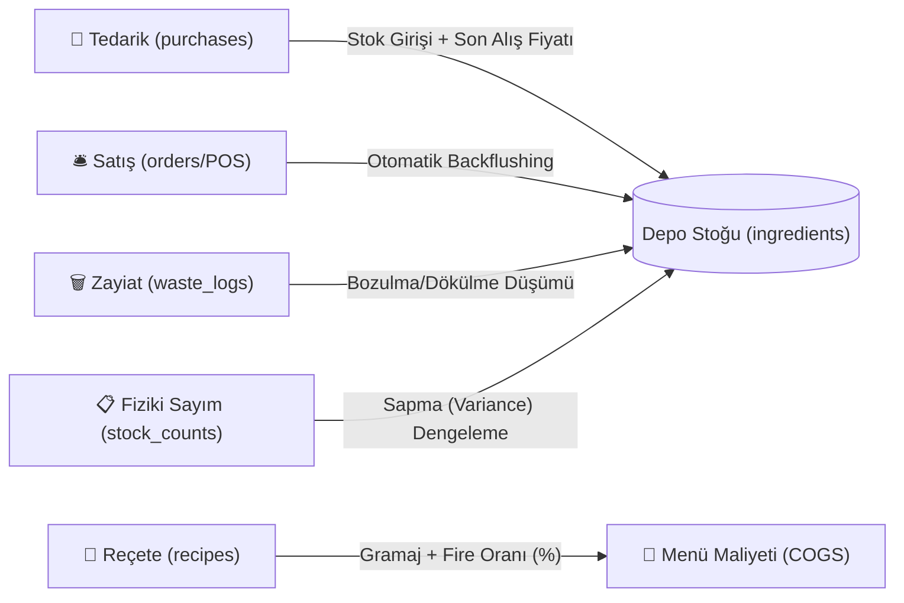

# 🍳 Mutfak ERP | Profesyonel Restoran Stok, Reçete ve Maliyet Yönetim Sistemi

[](https://github.com/hakan0123/mutfak-erp/releases/tag/v1.0.0)
[](https://nodejs.org)
[](https://sqlite.org)
[]()
[-brightgreen)]()
[](LICENSE)

Restoran, kafe ve profesyonel mutfak operasyonları için geliştirilmiş; **canlı Food Cost (%) analizi**, **otomatik reçete bazlı stok düşümü (Backflushing)**, **fiziki sayım sapma (Variance) dengelemesi** ve **zayiat/fire takibi** sunan yeni nesil mutfak ERP sistemi.

---

## 📌 Proje Veri Akışı ve Mutfak Yaşam Döngüsü



---

## 🗓️ Tamamlanan Geliştirme Yol Haritası (Milestones)

Bu proje, 5 günlük aşamalı geliştirme modeliyle planlanmış ve tüm fazları başarıyla tamamlanmıştır:

| Faz / Gün | Kapsam | Durum |
|---|---|---|
| **Gün 1** | 🏛️ **Temel Mimari & Veritabanı Şeması**: Proje iskeleti, `.gitignore`, SQLite ilişkisel DDL şeması, sanal kolonlar (`STORED GENERATED`) ve başlangıç tohumlama mekanizması. | ✅ **Yayınlandı** |
| **Gün 2** | ⚡ **Tetikleyiciler & Backflushing Motoru**: Otomatik stok girişi, reçeteli sipariş düşümü (`trg_order_item_backflush`), sipariş iptalinde iade (`trg_order_cancelled_restock`), zayiat ve sayım eşitleme tetikleyicileri + birim testler (`tests/triggers.test.js`). | ✅ **Yayınlandı** |
| **Gün 3** | 🔌 **Backend REST API & Analitik Sorgular**: Express.js servisleri, Food Cost % hesabı (Query B), Menü Karlılığı (Query A), Kritik Stok Servisi (Query C) ve Sapma Analizi (Query D) + API testleri (`tests/api.test.js`). | ✅ **Yayınlandı** |
| **Gün 4** | 🖥️ **Frontend & POS Arayüzü**: Dokunmatik POS ekranı, canlı adisyon sepeti, gerçek zamanlı stok kartları, reçete maliyet simülatörü ve Tailwind CSS teması (`public/`). | ✅ **Yayınlandı** |
| **Gün 5 (Final)** | 📊 **Fiziki Sayım Modülü, Raporlar & v1.0.0 Release**: Sayım oturumu modalı, Query D sapma maliyet analizi (`tests/variance.test.js`), kapsamlı dokümantasyon ve `v1.0.0` sürüm yayını. | ✅ **Yayınlandı** |

---

## ✨ Öne Çıkan Özellikler

### 1. Canlı Food Cost % Analitiği & Göstergeleri
* **Sektör Hedefi (%28 – %35)**: Mutfak maliyetini satış hasılatına oranlayarak işletmenin hedefin neresinde olduğunu renkli sayaçla gösterir.
* **Brüt Kar & Kar Marjı (%)**: Satış cirosundan mutfak maliyetini (COGS) çıkararak net brüt karı canlı hesaplar.
* **Depo Varlık Değeri (TL)**: Depodaki tüm hammaddelerin son alış fiyatlarına göre anlık toplam parasal değerini sunar.

### 2. Akıllı Backflushing (Reçeteli Otomatik Stok Düşümü)
* Kasiyer veya garson POS ekranından Cheeseburger sattığı anda:
  * Dana Kıyma: `150g` düşer.
  * Brioş Ekmek: `1 adet` düşer.
  * Cheddar Peyniri: `%5 fire payıyla` birlikte `21g` depodan otomatik düşer.
* **İptal Güvencesi**: Sipariş iptal edilirse `trg_order_cancelled_restock` tetikleyicisi malzemeleri anında stoka iade eder.

### 3. Fiziki Sayım & Sapma (Variance / Query D) Analizi
* Dönemsel mutfak sayım oturumu başlatılır, sistem teorik stoğu otomatik getirir.
* Sayım ekibi fiziki sayılan miktarı girdiğinde sistem anında:
  $$\text{Sapma (Variance)} = \text{Teorik Stok} - \text{Fiziki Sayılan}$$
  $$\text{Mali Zarar/Kazanç} = \text{Sapma Miktarı} \times \text{Birim Alış Fiyatı}$$
  değerlerini hesaplar ve tek tıkla depo stoklarını fiziki sayıma eşitler.

---

## 📡 REST API Referansı

| Metot | Uç Nokta (Endpoint) | Açıklama |
|---|---|---|
| `GET` | `/api/dashboard` | Canlı Food Cost %, toplam ciro, mutfak maliyeti, kar marjı ve kritik stoklar |
| `GET` | `/api/ingredients` | Tüm hammadde kartları, birimler, anlık stok ve parasal değerler |
| `POST/PUT/DELETE` | `/api/ingredients` | Hammadde tanımlama, düzenleme ve silme |
| `GET` | `/api/menu-items` | Menü ürünleri, porsiyon maliyeti ve kar marjı (Query A) |
| `GET/POST` | `/api/menu-items/:id/recipe`| Menü ürününün reçete dökümü ve porsiyon fire oranları |
| `GET/POST` | `/api/purchases` | Alış faturaları ve irsaliye girişi (otomatik stok artışı) |
| `GET/POST` | `/api/orders` | POS adisyon satışı (otomatik backflushing) |
| `PUT` | `/api/orders/:id/status` | Sipariş durum güncellemesi (iptal durumunda stok iadesi) |
| `GET/POST/DELETE` | `/api/waste` | Bozulma/dökülme kaynaklı zayiat takibi |
| `GET/POST` | `/api/stock-counts` | Yeni fiziki sayım oturumu başlatma |
| `PUT` | `/api/stock-counts/:id/complete`| Fiziki sayımı onaylayıp depo stoklarını eşitleme |
| `GET` | `/api/reports/variance` | Query D sapma (variance) analizi ve mali etki raporu |
| `GET` | `/api/reports/menu-matrix` | Menü Mühendisliği Matrisi (Yıldızlar, Sabanlar, Bilmeceler, Köpekler) |

---

## 🧪 Otomasyon Test Paketi

Proje 4 farklı test paketi ve toplam **39 doğrulanmış assertions** içerir:

```bash
# Tüm testleri tek komutla çalıştırın:
npm test

# Veya paket bazında çalıştırın:
npm run test:schema     # Veritabanı şema ve sanal kolon testleri
npm run test:triggers   # 7 adet SQLite tetikleyici ve backflushing testleri (13 test)
npm run test:api        # REST API HTTP uç nokta yanıt testleri (17 test)
npm run test:variance   # Fiziki sayım ve Query D sapma analiz testleri (9 test)
```

---

## 🚀 Hızlı Başlangıç

```bash
# 1. Depoyu klonlayın
git clone https://github.com/hakan0123/mutfak-erp.git
cd mutfak-erp

# 2. Bağımlılıkları yükleyin
npm install

# 3. Sunucuyu başlatın
npm start
```

Tarayıcınızdan **`http://localhost:3000`** adresine giderek Mutfak ERP sistemini hemen kullanmaya başlayabilirsiniz!

---

## 🏷️ Sürüm Bilgisi (v1.0.0 Release Notes)
* **v1.0.0**: Üretim ortamına hazır Mutfak ERP ilk kararlı sürümü. Tam entegre SQLite tetikleyicileri, Express.js REST API, responsive koyu mod SPA arayüzü, canlı POS terminali ve Query A, B, C, D analitik raporlama motoru yayınlandı.

---

## 📄 Lisans
Bu proje [MIT](LICENSE) lisansı ile lisanslanmıştır.
